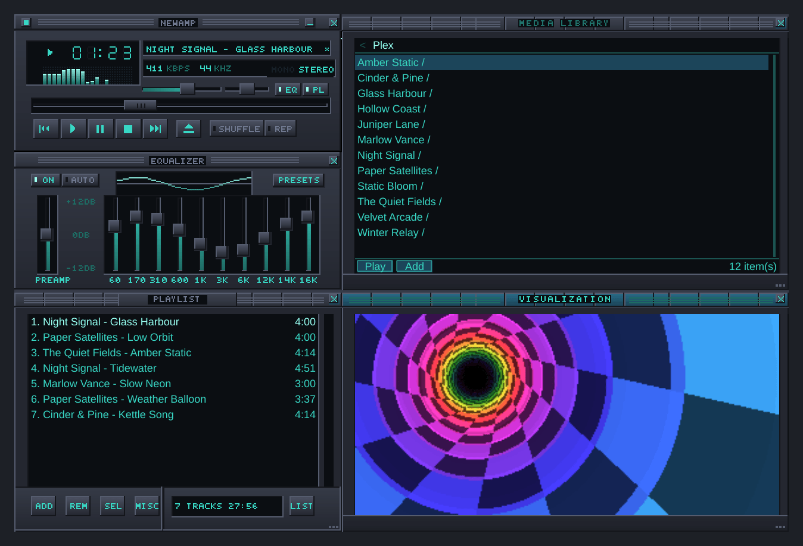
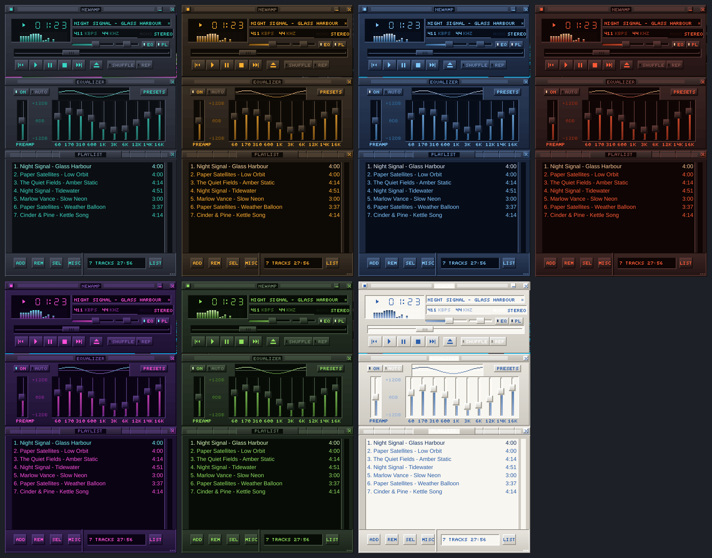
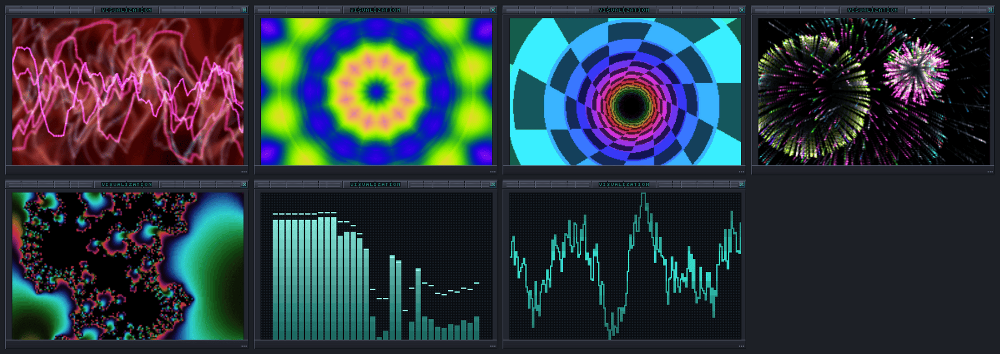

# NewAmp

An open-source, Qt 6 music player in the spirit of classic WinAmp: small, fast,
skinnable, and multi-window. Out of the box it plays local files; Plex, Jellyfin,
DLNA and Spotify are optional plugins, each loaded only when you turn it on.



## Screenshots

NewAmp comes with seven colour themes of its own, all drawn in code:



The visualizer window has feedback trails, a kaleidoscope, a tunnel,
fireworks, a Mandelbrot zoom, and big classic bars and scope:



## Features

- **Classic WinAmp layout.** Main window, equalizer and playlist, plus a Media
  Library and a visualizer. Windows snap to each other and to the screen edges,
  and windows docked to the main window move with it. The layout is saved
  between runs.
- **Skins.** Seven colour themes of NewAmp's own (NewAmp Slate, Amber
  Terminal, Glacier, Ember, Synthwave, Forest and Paper), all drawn in code.
  NewAmp also loads classic WinAmp `.wsz` skins and unpacked skin folders:
  right-click, then *Skins* › *Load skin...*, or drop them into the skins
  folder. *Get more skins...* opens [skins.webamp.org](https://skins.webamp.org).
  No third-party skins are bundled.
- **Scale.** The whole interface scales from 1× to 4×, under *Scale* in the
  right-click menu.
- **Local playback.** MP3, FLAC, WAV and Ogg Vorbis through NewAmp's own
  decoder, and anything else the platform can decode (AAC/M4A, ALAC, Opus...).
  Open files or folders from the right-click menu, or drop them on the main
  window or playlist.
- **Playlists.** *Load list* and *Save list* in the playlist's LIST OPTS menu.
  A playlist can mix sources: local files, web streams, and tracks from Plex,
  Jellyfin, DLNA and Spotify, kept in NewAmp's own format (`.nap`). M3U, M3U8
  and PLS open and save too, for other players; they hold local files and web
  streams only, so plugin tracks are left out of them (NewAmp says how many).
  When a track's source isn't available (its plugin is off, you're signed out,
  or the server can't be reached), the track is marked and skipped, and the
  next one plays.
- **Internet radio.** *Open URL* (Ctrl+L) in the main menu, or *Add URL* in
  the playlist, takes a stream address or a station's `.pls` / `.m3u` link.
  Station and song titles come from the stream (SHOUTcast/Icecast metadata),
  read over a second connection to the station, which costs as much data as
  the stream itself. Radio plays through the platform's player, so the
  equalizer and visualizer don't apply to it yet.
- **Equalizer.** Ten bands, preamp and balance, applied to local files and to
  music streamed from Plex, Jellyfin and DLNA servers.
- **Visualizations.** Feedback trails, Kaleidoscope, Tunnel, Fireworks, a
  Mandelbrot zoom, and the classic Spectrum and Oscilloscope. Click the window
  for the next effect; right-click to pick one, change effect on each new
  track, or cycle every 10 to 60 seconds.
- **Media Library.** Browses the music the plugins below offer. Type to filter
  the current folder; press Ctrl+F (⌘F on macOS) or the *Find* button to
  search the whole library, where the service supports it.

## Plugins

NewAmp plays local files out of the box. Everything else is an optional
plugin, built and shipped alongside the app but loaded only when you turn it
on: right-click, then *Plugins*, tick the one you want and restart NewAmp.
Each plugin then adds its own submenu to the right-click menu, for signing
in and browsing.

- **Plex.** Sign in with your plex.tv account; NewAmp finds your servers
  (local, remote or relay, whichever answers) and browses artists, albums,
  tracks and playlists. Plays are reported back to Plex, like PlexAmp. On
  macOS 15 and later, allow NewAmp on the local network when asked.
- **Jellyfin.** Sign in with a user name and password, or an API key. Servers
  on your network are found automatically. Browse and search music libraries
  and playlists; plays are reported back to Jellyfin (10.9 or later).
- **DLNA / UPnP.** Finds media servers on the local network (MiniDLNA, Plex's
  and Jellyfin's DLNA servers, most NAS boxes), browses and searches them.
  Servers that discovery can't reach can be added by address.
- **Spotify.** Browse and search your playlists, liked songs, saved albums and
  followed artists, and play them. Needs Spotify Premium. Spotify's audio is
  protected, so the equalizer and visualizer don't apply to it.

### Setting up Spotify

Spotify only lets an app talk to it once someone has registered it, so each
user registers their own (it's free):

1. Open the [Spotify developer dashboard](https://developer.spotify.com/dashboard)
   and create an app.
2. Add the redirect URI `http://127.0.0.1:43827/callback`.
3. Tick *Web API*, save, and copy the app's client ID.
4. In NewAmp, open *Spotify* › *Spotify client ID...* from the right-click
   menu, paste the ID, and sign in in the browser window that opens.

On macOS, NewAmp plays Spotify itself, through the system web view, so you
don't need the Spotify app. On every platform it can also play through
Spotify Connect: the Spotify app on this computer, your phone, or a speaker.
Pick one under *Spotify* › *Play on...*.

Spotify keeps apps in development mode to five users, and lets them read only
the playlists you own or collaborate on. Other playlists still play, as a
whole.

## Keyboard

In the main window, equalizer, playlist and visualizer:

| Key | Action |
| --- | --- |
| Z, X, C, V, B | Previous, play, pause, stop, next |
| Space | Play or pause |
| ← / → | Seek back / forward 5 seconds |
| ↑ / ↓ | Volume up / down |
| L | Open files (main window) |
| Ctrl+L | Open URL |
| Ctrl+Shift+L | Show or hide the Media Library |
| Ctrl+Shift+V | Show or hide the visualizer |
| Ctrl+= / Ctrl+- | Larger / smaller interface |
| Ctrl+D | Double size |

In the playlist, ↑ and ↓ move the selection, Enter plays it, Delete removes it
and Ctrl+A selects everything. In the Media Library, typing filters, Ctrl+F
searches, Enter or → opens, and ← or Backspace goes back. On macOS, Ctrl means
⌘.

## Status and roadmap

NewAmp is in early development, but everything above works today.

Done:

1. **Foundation and local playback**: Qt 6 / C++ / CMake, skinned main window,
   NewAmp's own audio pipeline with equalizer and balance.
2. **Classic skins and multi-window**: `.wsz` skins, playlist and equalizer
   windows, snapping and docking, interface scaling.
3. **Plex (optional plugin)**, in the style of PlexAmp.
4. **Jellyfin (optional plugin)**.
5. **DLNA / UPnP (optional plugin)**.
6. **Spotify (optional plugin)**, through Spotify Connect, and NewAmp's own
   player on macOS.
7. **Media Library and visualizations**.

Next: NewAmp's own Spotify player on Windows and Linux, keeping sign-in tokens
in the system keychain rather than the settings file, and more original
themes.

## Downloads

Every push to `main` builds:

- **macOS**: a universal disk image (`NewAmp-macOS`), for Apple silicon and
  Intel.
- **Linux**: an AppImage (`NewAmp-Linux`).
- **Windows**: a zip (`NewAmp-Windows`); unzip it and run `NewAmp.exe`.

Find them under *Artifacts* on the latest run of the
[CI workflow](https://github.com/TheJoshGriffith/NewAmp/actions/workflows/ci.yml).
The builds are unsigned: on macOS, right-click the app and choose Open the
first time; on Windows, choose More info, then Run anyway.

## Building

Requires Qt 6.4+ (Core, Gui, Widgets, Multimedia, Network) and CMake 3.21+.
zlib comes from the system where there is one and is built from source
otherwise (Windows).

```sh
cmake -S . -B build -DCMAKE_BUILD_TYPE=Release
cmake --build build
ctest --test-dir build --output-on-failure
```

The screenshots above are rendered headless by a small tool. To refresh them,
configure with `-DNEWAMP_BUILD_SCREENSHOTS=ON`, build, and run
`QT_QPA_PLATFORM=offscreen build/newamp_screenshots docs/screenshots`. With an
audio device (a PulseAudio null sink is enough), the time and meters show
playback.

On macOS with Homebrew: `brew install qt cmake`, then pass
`-DCMAKE_PREFIX_PATH=$(brew --prefix qt)` to the first command. On Windows, use
the Qt online installer (MSVC 2022 64-bit, plus Qt Multimedia) and build from a
Visual Studio developer prompt with `-G Ninja`.

## License

GPL-3.0-or-later. See [LICENSE](LICENSE).
